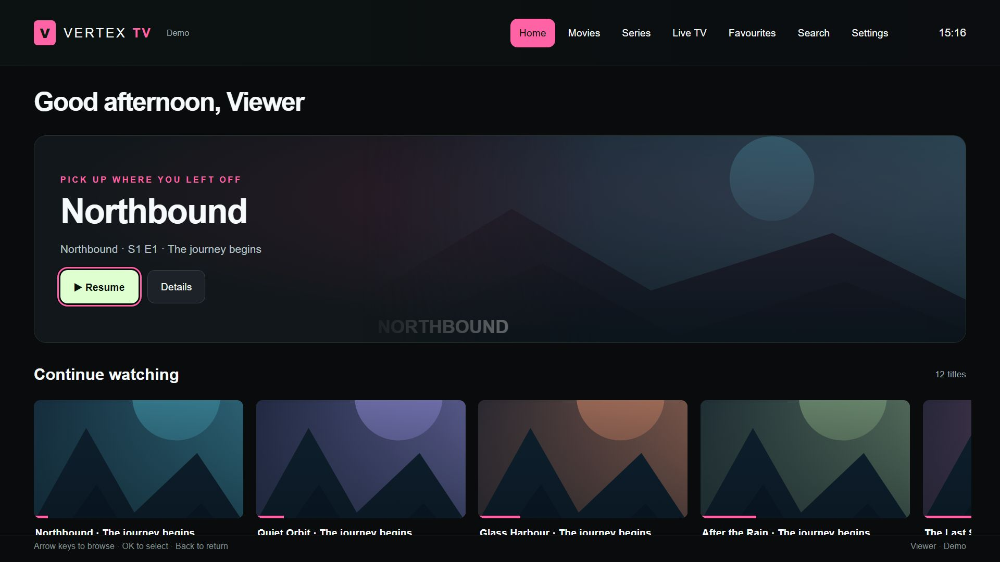

# Project portfolio

Practical software and infrastructure projects by **Kyle Cowens**, developed around real use and tested in the homelab.

| Project | What it solves | Technology |
|---|---|---|
| [Vertex TV](tv-apps/vertex-tv.md) | A Jellyfin experience designed for a television remote, with explicit control over playback conversion | JavaScript, Jellyfin API, Samsung AVPlay, IndexedDB |
| [Samsung home launcher](tv-apps/home-launcher.md) | A personal home screen with app favourites, HDMI shortcuts and weather | HTML, CSS, JavaScript, Tizen TV APIs |

The case studies include screenshots captured directly from the running app interfaces in a browser preview. Library content, account labels, weather and personal artwork are replaced with demonstration data.

[About Kyle Cowens](https://vertexhomelab.co.uk/kyle-cowens/) · [Vertex Homelab](https://vertexhomelab.co.uk) · [Repository overview](../README.md)
