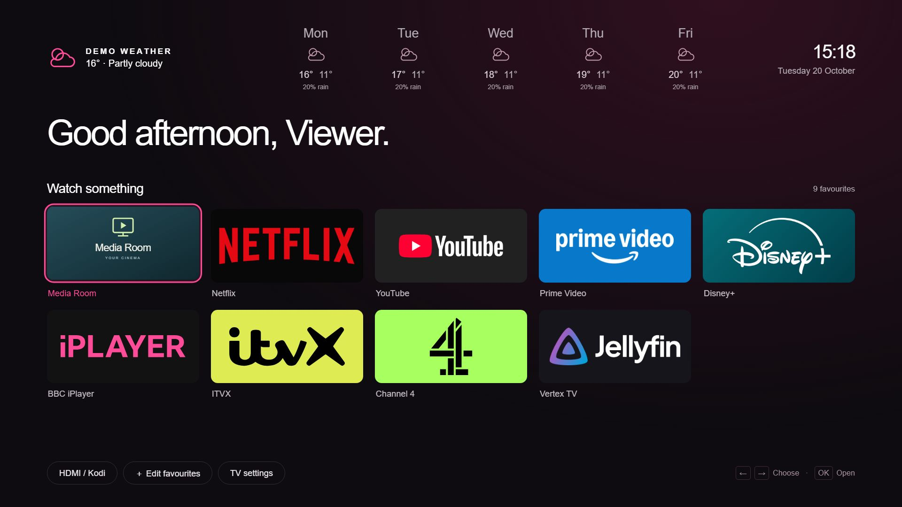
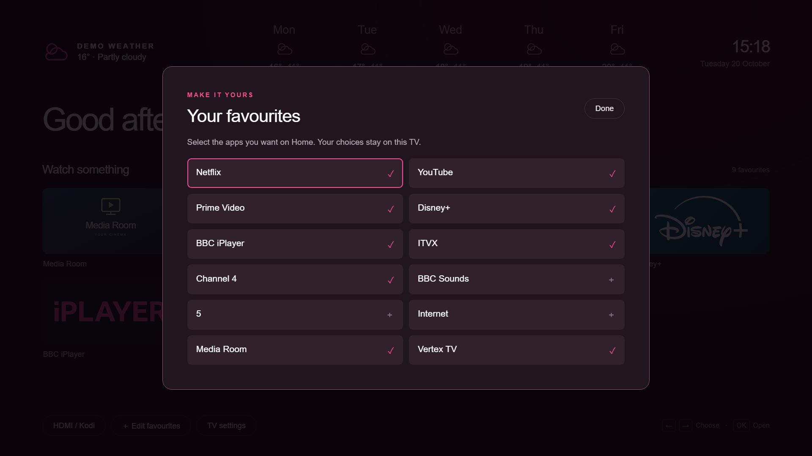
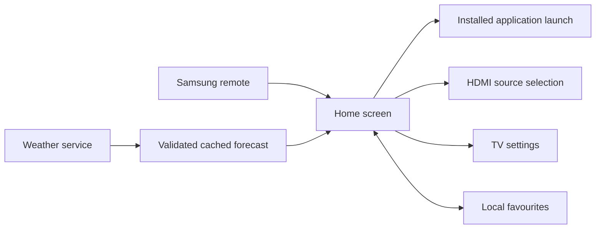

# Samsung TV home launcher

**A simpler starting point for the television: favourite apps, the media-player input, useful weather and controls that work with the existing remote.**

Project by [Kyle Cowens](https://vertexhomelab.co.uk/kyle-cowens/), developed with AI-assisted coding and tested through everyday use on two Samsung televisions.

*Actual launcher UI in a browser preview. Weather and the viewer label are sample data; the personal media-input photograph is replaced with a generic illustration.*

## The experience

The launcher puts common actions on one screen. Favourite tiles open installed streaming apps or switch to an HDMI source. The favourites editor keeps the full app catalogue available while allowing each television to have its own shorter selection.

The presentation uses a dark background, strong focus outlines, recognisable service artwork, a clock and a five-day weather strip. The greeting treats the overnight hours as evening and switches to morning at six.

## Features

- Per-device favourites saved locally.
- Direct HDMI shortcuts and a source picker.
- Launching installed streaming applications.
- A shortcut to the separate Vertex TV Jellyfin client.
- Access to television settings.
- A favourites editor navigated with the remote.
- Dark YouTube artwork and individually styled service tiles.
- Current conditions and a five-day forecast, with cached weather and offline handling.
- Different accent themes and input mappings for each television.

## Platform integration

The HTML, CSS and JavaScript interface is packaged for Tizen. Application-launch and input-selection calls connect it to television functions. A separate device configuration supplies the desired theme, favourites and HDMI selection.

Home-button behaviour and app handoffs required device-specific integration. BBC iPlayer needed a different launch path from other streaming apps, and returning from it needed separate handling. These behaviours were tested on the target televisions; compatibility across other models and firmware is not established.

## LG port and shared build

The same launcher interface also has an LG webOS build. A build adapter maps Samsung app identifiers to the actual installed LG apps and replaces launch/input actions with Luna service calls through `PalmServiceBridge`. App IDs were checked on the target television rather than assumed from display names. An aerial Live TV tile opens LG's television app, while an LG Home button provides access to the stock interface.

The older LG browser needs JavaScript transpilation, runtime polyfills and explicit flex-layout/spacing adaptations. These are applied during the build, keeping a common interface source. Favourites remain in local storage; migrations update obsolete app IDs without resetting the viewer's order. The editor has a remote-operated reorder mode: select a tile, move it with arrows, confirm to place it, or Back to cancel the move.

Home-button routing and startup use device-specific integration, investigated and verified separately from ordinary app packaging. Developer Mode was used for initial pairing; subsequent persistent device integration uses locally managed access. The public write-up omits access keys and deployment settings. This is an installed application and integration layer; the original TV operating system remains in place.

## What testing changed

The first working version exposed several practical differences between a desktop preview and a real TV:

- An app ID alone was insufficient for the iPlayer handoff.
- Selecting an input had to switch the active video source successfully.
- Settings could take longer on its first launch.
- Artwork that looked acceptable as a small icon needed better sizing to fill a large television tile.
- Per-device input mappings and favourites needed to survive updates.

User testing confirmed app launching, the corrected iPlayer return, HDMI switching, settings and favourite editing. Subsequent iterations added the weather strip, themes and improved artwork.

## Scope and attribution

This is a custom launcher application with device integration. It does not replace the television firmware or change the underlying decoder capabilities.

Service logos identify the applications being launched and belong to their respective owners. Their appearance does not imply endorsement. Weather integration uses Open-Meteo; the screenshots use fictional sample conditions without querying a personal location.

The public documentation excludes personal photographs, device identifiers, private network addresses, signing material and deployment scripts.

[Vertex TV case study](vertex-tv.md) · [Project portfolio](../README.md) · [Vertex Homelab](https://vertexhomelab.co.uk)
