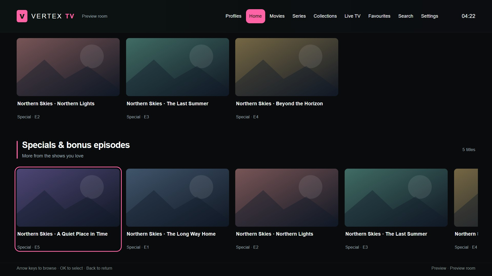
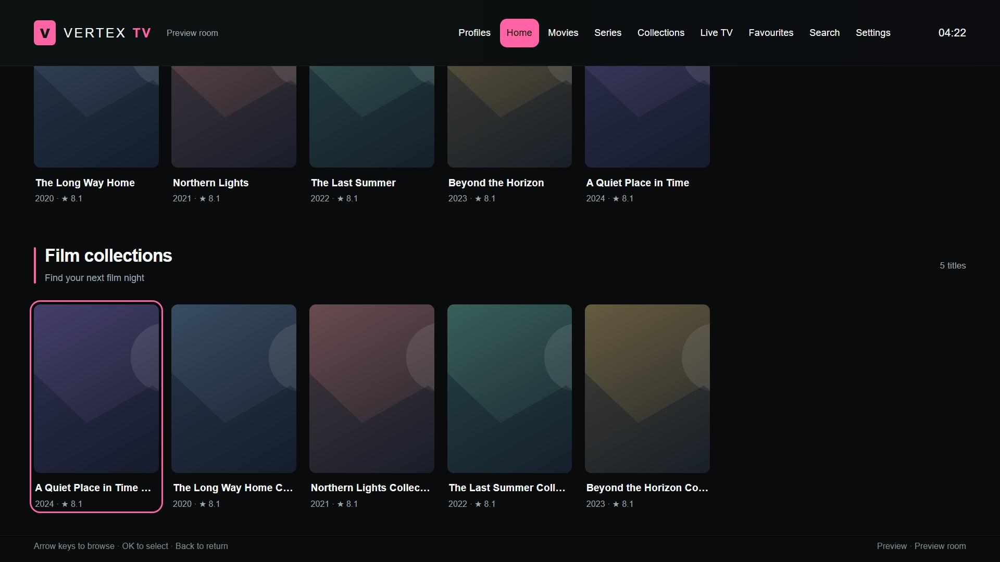
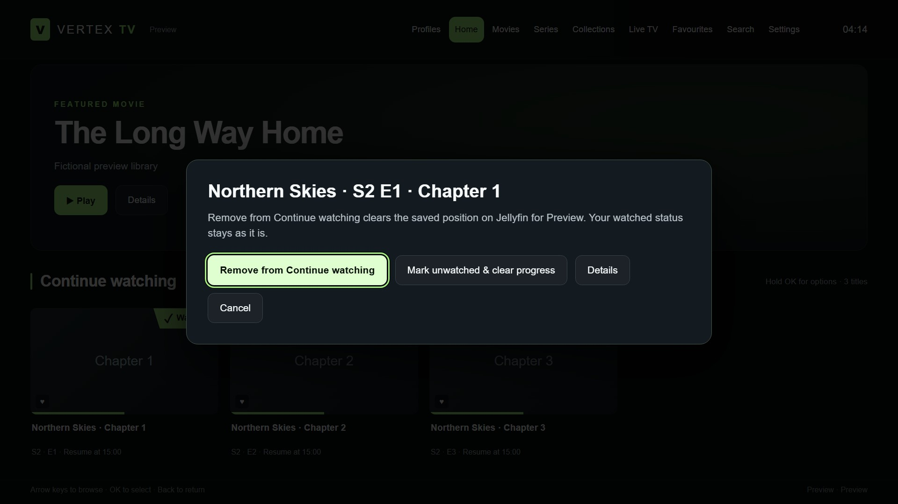
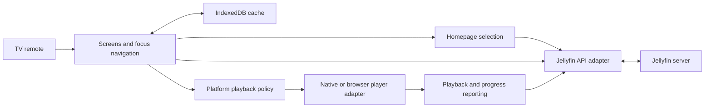

# Vertex TV — a Jellyfin client for television remotes

**A television-first media client built around comfortable remote navigation, predictable playback and a homepage drawn from the viewer's own library.**

Project by [Kyle Cowens](https://vertexhomelab.co.uk/kyle-cowens/), developed with AI-assisted coding and iterative testing on physical televisions.

*Actual app interface in a browser preview. Titles, artwork, account and room labels are fictional demonstration data. Latest Samsung release: **0.1.21**, 22 October 2026. See the [release history](CHANGELOG.md).*

## The problem

Browser-style interfaces can be awkward on televisions: text fields capture focus, navigating rows can skip controls, and leaving playback to offer the next episode breaks the viewing flow. A generic homepage can also devote space to sections with no content.

Vertex TV brings navigation, library selection and playback decisions into the client. The Samsung build is a signed Tizen web application using native AVPlay. An LG webOS port also runs on a physical television, with a separate compatibility policy.

## A homepage built from the library

Below the featured film, the homepage follows this order:

1. **Continue watching and Up next** — return to something already underway.
2. **Specials & bonus episodes** — Season 0 episodes, with selected specials catalogued as films merged in and duplicate appearances removed.
3. **Recently added** — separate film and series rows.
4. **Film collections** — populated collections that open their member titles.
5. **Discovery** — one populated row selected daily: a 40–90 minute film, highly rated titles, unwatched films or a genre selection.

Larger headings, narrow theme-coloured accent lines and spacing separate the sections without putting every row inside another panel. Long landscape-card titles wrap to two lines. Empty rows and empty collections are omitted; missing and virtual items are excluded from the new discovery data.

The new catalogue queries are scoped to the signed-in account and paginated. Discovery selection is stable for that account and day. Home does not rebuild on an idle timer or shuffle while someone is browsing. Navigation and explicit refresh retrieve current data.

## Playback and remote controls

Up Next appears in the top-right corner during the final 30 seconds of an episode. Its countdown follows playback position, so pausing or buffering cannot advance it. **Play next** changes episodes inside the player. **Keep watching** dismisses the offer and suppresses automatic progression for that episode; the autoplay preference is respected.

Back first dismisses an open playback dialog or visible transport controls. With the controls hidden, Back exits playback to the library. A held Back key does not count as successive exit requests. **Close player** remains available as an explicit exit action.

Holding OK on a Continue watching tile opens options to clear its saved position on Jellyfin. The viewer can also explicitly mark the item watched or unwatched while clearing progress. The client waits for server confirmation before removing the tile. Clearing only the position preserves watched status, favourites and play count, and operates on the current profile. Item details provide the same options as a fallback.

Other features include movie and series browsing, collections, seasons, search, favourites, watched ribbons, Live TV listings, audio selection and text subtitles. Movies and series load further pages as the viewer moves down. Quick Connect starts with remote focus, and remembered profiles validate their sessions before switching.

## Architecture

Rendering, catalogue selection, API access, caching and playback are separate modules. The Samsung cache has a quota-adjusted disk target of up to 384 MB and a bounded memory fallback. Cleanup happens when switching tabs rather than evicting artwork during browsing. If the operating system rejects a cache write, the fetched image can still be displayed.

## Playback policy

Samsung films and episodes prefer Direct Play and permit repackaging or audio conversion when the original video can be copied. Requests requiring video conversion are rejected with an explanation. Live TV has a separate compatibility path that can convert to H.264/AAC up to 1080p.

The LG port can request compatible video conversion for unsupported files when the account permits it. This happens during playback; it does not replace library files. Text subtitles are drawn separately from the video where supported.

## Validation and current limits

Samsung **0.1.21** is installed on two televisions. Live playback was checked before updating; neither update interrupted an episode. User testing confirmed Back-button behaviour on a physical Samsung, along with earlier Quick Connect, library browsing and selected Direct Play playback.

The shared suite has **80 passing tests** covering playback policy, subtitles, navigation, profiles, resume updates, caching, pagination, Up Next and homepage selection. Browser checks at 1920 × 1080 verify row order, visible headings and focus, collection navigation, empty and failed data sources, server-confirmed resume changes against a fixture, and continuous next-episode handoff. These previews use fictional data and do not modify a live library.

Physical confirmation of the newest homepage remains pending. Native long-press behaviour and broader codec, audio-conversion and subtitle coverage still need device testing. One previous update was followed by sign-in loss; its cause and session retention remain unresolved. Universal codec compatibility and an audio-sync fix are not claimed.

The LG television runs an earlier port release; the newest Samsung homepage and player changes have not been deployed there.

## Publication scope

This case study contains documentation and clean interface captures. Deployment addresses, server configuration, signing certificates, session data, operational logs and private media are excluded.

[Release history](CHANGELOG.md) · [Home launcher case study](home-launcher.md) · [Project portfolio](../README.md) · [Vertex Homelab](https://vertexhomelab.co.uk)
