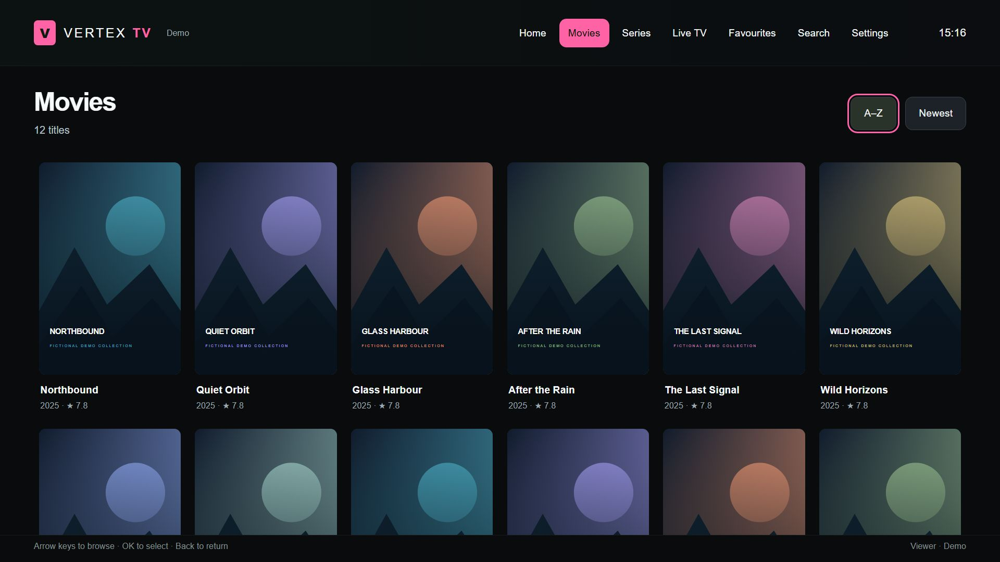
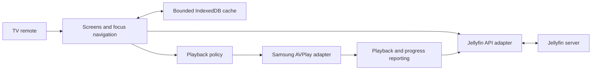

# Vertex TV — a Jellyfin client for Samsung TVs

**A television-first media client built around a simple requirement: make browsing comfortable with a remote, and preserve the original video whenever possible.**

Project by [Kyle Cowens](https://vertexhomelab.co.uk/kyle-cowens/), developed with AI-assisted coding and iterative testing on physical televisions.

*Actual app interface in a browser preview. Titles, progress, artwork and account labels are fictional demonstration data.*

## The problem

A browser-style interface can be awkward on a television: text fields capture focus, moving quickly through rows can skip controls, and automatic video conversion can place a heavy load on the media server.

Vertex TV brings the interaction model and playback decisions into the client. It is packaged as a signed Tizen web application and uses Samsung's native AVPlay engine for television playback.

## What was built

- A home screen with resume, continue watching, next-up episodes and recent library additions.
- Movie and series browsing, seasons, episodes, search, favourites and watched-state controls.
- A series-level play button that selects an unfinished episode or the next unwatched episode.
- Quick Connect as the initial sign-in focus, plus explicit username and password editors.
- Live TV browsing and available programme information.
- Playback controls, audio-track selection, text-subtitle overlays, resume reporting and a next-episode prompt.
- A bounded 96 MB artwork and metadata cache with automatic eviction.
- Green and pink accent themes, large controls and visible remote focus.

## Architecture

The screen layer, API adapter, cache, playback policy and player adapter are separate modules. Pure functions cover navigation, subtitle cue parsing, episode selection and playback decisions. Keeping the platform player behind an adapter leaves room for a future television platform without promising that port is already complete.

## Playback decisions

Direct Play is preferred. Where the original video can be preserved, the client can request repackaging or audio conversion. A request requiring video conversion is rejected with an explanation rather than silently placing a heavy encoding job on the server.

Text subtitles are displayed separately from the video. This avoids deliberately selecting video burn-in for those subtitles. Support still depends on the source format, server response and television decoder; a browser preview does not establish television codec compatibility.

## Iteration driven by real use

| Observed issue | Change |
|---|---|
| The username keyboard trapped the initial navigation | Start on Quick Connect and open text fields in explicit editors with a return path |
| Opening a series required navigating through seasons before playing | Add a series-level play/resume action |
| Fast upward navigation skipped grid rows | Resolve movement inside the grid before moving to the header |
| Returning to the banner left content hidden, while the final row touched the footer | Scroll the content container explicitly, restore the top on hero focus, and reserve space around focused rows |

## Validation and current limits

The client has been installed on two Samsung Tizen 8 televisions. User testing confirmed Quick Connect, library browsing, Live TV listing and fast Direct Play of selected episodes.

The local core suite contains 16 passing tests covering playback policy, subtitle parsing, navigation, episode selection and scroll bounds. The latest padding and scroll changes were also checked at a 1920 × 1080 browser viewport: the final row clears the footer, and returning to the hero reveals the greeting.

The latest layout changes are installed on both televisions, with a physical remote retest still pending. Audio conversion, unusual subtitle formats, cache pressure and broader codec coverage remain areas for further device testing. Universal codec support and an audio-sync fix are not claimed.

## Publication scope

This case study contains documentation and clean interface captures. Deployment addresses, server configuration, signing certificates, session data and private media are excluded.

[Home launcher case study](home-launcher.md) · [Project portfolio](../README.md) · [Vertex Homelab](https://vertexhomelab.co.uk)
